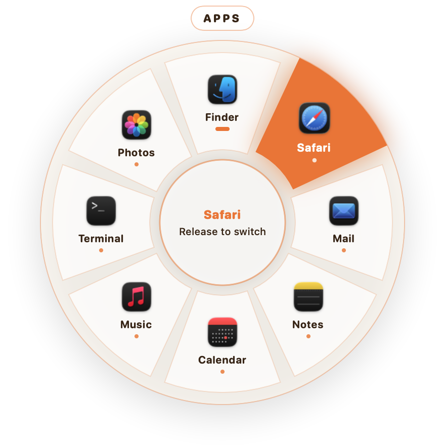
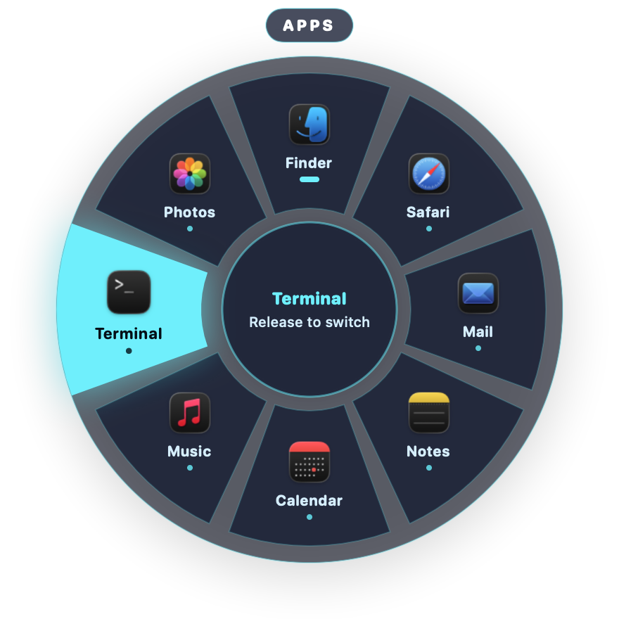

<p align="center">
  
  
</p>

<h1 align="center">Whirl</h1>

<p align="center">
  <b>Hold a key. Flick toward an app. Let go.</b><br>
  A free, open-source radial app switcher for macOS and Windows that works entirely on your computer.
</p>

<p align="center">
  <a href="../../releases/latest">Download</a> ·
  <a href="#install">Install</a> ·
  <a href="#permissions-and-privacy">Permissions & privacy</a> ·
  <a href="#build-from-source">Build from source</a> ·
  <a href="#română">Română</a>
</p>

---

## What it does

Hold **⌥ Tab** (Mac) or **Ctrl + Alt + Tab** (Windows). A wheel of eight slices opens under your cursor, each showing an app's icon and name. Move the mouse toward a slice and let go of the keys: that app comes to the front.

- **Most recent first.** Slices are ordered by when you last used each app.
- **Pinned favourites.** Pin apps and they take fixed slices, in the order you pin them, even when closed. Choosing a closed one launches it.
- **More than eight apps?** Press the shortcut's key again (Tab) or scroll to turn the page. Shift + Tab goes back.
- **Quick tap.** Tap the shortcut and let go without moving the mouse, and you jump back to the previous app, like ⌘Tab.
- **Cancel** with Esc, or let go over the middle of the wheel.
- **Click a slice** instead of letting go, if you prefer.
- **Windows mode (optional).** One slice per window instead of per app.
- **Five themes**, the same as [DragWheel](https://github.com/nico43245/DragWheel).

Whirl is by the author of DragWheel: same wheel, new tool.

## Install

Download the latest version from the [Releases page](../../releases/latest).

### macOS 14 Sonoma or later

1. Download `Whirl-<version>-macOS.dmg`, open it, and drag **Whirl** to **Applications**.
2. The first time you open it, macOS warns that the app is from an unidentified developer. Whirl is free and open source and isn't enrolled in Apple's paid developer program. To open it anyway:
   1. Open it once and close the warning.
   2. Go to **System Settings → Privacy & Security** and click **Open Anyway**.
3. Hold **⌥ Tab**. That's it: apps mode needs **no permission**.

### Windows 10 (2004+) and Windows 11, 64-bit

1. Download `Whirl-<version>-Windows-Setup.exe` and run it. It installs only for your user and doesn't need administrator rights.
2. Windows SmartScreen may say it "protected your PC", because the app isn't code-signed. Click **More info → Run anyway**.
3. Whirl starts in the notification area next to the clock. Hold **Ctrl + Alt + Tab**.

There's also a `Windows-portable.zip` if you'd rather not install anything. Unzip it and run `Whirl.exe`.

## Permissions and privacy

| | macOS | Windows |
| --- | --- | --- |
| Apps mode (default) | **None.** | None, no administrator rights. |
| Windows mode (optional) | **Accessibility**, to list and raise individual windows. | None. |
| Screen Recording | **Not needed.** Whirl never captures your screen or window contents. | Not applicable. |

- **No internet use.** No accounts, analytics, telemetry, ads or update pings.
- **No typing is read.** On macOS, Whirl registers a single system hotkey and sees nothing else of the keyboard. On Windows it uses a low-level keyboard hook that reacts only to Ctrl, Alt, Shift, Win, the shortcut's key and Esc. See [PRIVACY.md](PRIVACY.md).
- **Verifiable builds.** Every release is built by [GitHub Actions](.github/workflows/release.yml) from the public source and ships with `SHA256SUMS.txt`. Public releases also carry a build-provenance attestation:
  ```bash
  gh attestation verify Whirl-1.0.0-macOS.dmg --repo nico43245/Whirl
  ```

See [SECURITY.md](SECURITY.md) for how to report a vulnerability.

## What has been tested

Being upfront about this:

| | Status |
| --- | --- |
| macOS app | Built and run on Apple Silicon with macOS 26. The real shortcut was held, a slice chosen and the app brought to the front; unit tests and an end-to-end smoke test pass. Intel Macs and older macOS versions are untested. Windows mode (Accessibility) is **not yet tried**. |
| Windows app | Compiles, and its logic (slice geometry, ordering, shortcut handling, settings) is covered by unit tests on every push. The wheel window and the window switching have **not been tried by hand on a real Windows PC yet**. CI also runs a best-effort end-to-end check, which hosted runners may not support. |

If something misbehaves on Windows, please [open an issue](../../issues/new/choose).

## Known limits

- **Windows: Ctrl + Alt + Tab.** Whirl takes this shortcut over from Windows' own task view while it runs. If the system view still appears for you, choose another shortcut in Preferences.
- **Windows: Store apps** all run inside one Windows host process, so Whirl tells them apart by their window title.
- **Windows:** only apps with a window on the current virtual desktop are listed.
- **macOS:** Apps mode lists every regular app whatever Space it is on, but Windows mode lists only windows on the current Space.
- **macOS:** menu-bar-only apps (those without a Dock icon) aren't listed.
- A key already used by another app's global shortcut can't be taken. Pick a different one in Preferences.

## How it works

| | macOS | Windows |
| --- | --- | --- |
| Language | Swift, SwiftUI, AppKit | C#, .NET 10, WPF |
| Shortcut | Carbon `RegisterEventHotKey` | Low-level keyboard hook |
| Apps and order | `NSWorkspace` | `EnumWindows` (z-order) |
| Windows mode | Accessibility API | `EnumWindows` |
| Bringing to front | Same path as a Dock click | `SetForegroundWindow` |

Both apps can check themselves from the command line. They open the real wheel, steer it onto an app and verify the switch:

```bash
/Applications/Whirl.app/Contents/MacOS/Whirl --self-test
```

```powershell
Whirl.exe --self-test
```

## Build from source

**macOS** needs Xcode 15 or later:

```bash
macos/build.sh                       # → macos/build/Whirl.app
swift test --package-path macos      # unit tests
macos/scripts/smoke-test.sh          # end-to-end: real wheel, real switching
```

**Windows** needs the [.NET 10 SDK](https://dotnet.microsoft.com/download):

```powershell
dotnet test --solution windows/Whirl.slnx
windows/scripts/publish.ps1          # app folder, portable zip and installer (with Inno Setup 6)
```

The Windows logic library targets plain .NET, so its tests run on any OS.

## Uninstall

- **macOS:** quit Whirl from the menu bar and drag it from Applications to the Trash. To remove its settings too, run `defaults delete io.github.nico43245.whirl`.
- **Windows:** use **Settings → Apps → Whirl → Uninstall**. This also removes its settings and the start-at-sign-in entry.

## Credits

Third-party components and their licenses are listed in [THIRD-PARTY-NOTICES.md](THIRD-PARTY-NOTICES.md).

## License

[MIT](LICENSE)

---

## Română

**Whirl** este un comutator radial de aplicații pentru Mac și Windows, gratuit și open source, de la autorul DragWheel. Ții apăsat **⌥ Tab** (Mac) sau **Ctrl + Alt + Tab** (Windows), apare o roată cu 8 felii sub cursor, miști mouse-ul spre aplicația dorită și dai drumul tastelor: aplicația vine în față.

- **Instalare:** descarci de la [Releases](../../releases/latest). Pe Mac, la prima deschidere mergi la *System Settings → Privacy & Security → Open Anyway*. Pe Windows, la avertismentul SmartScreen apeși *More info → Run anyway*.
- **Permisiuni:** pe Mac, modul „Apps” nu cere nicio permisiune; modul „Windows” (opțional) cere doar *Accessibility*. Nu e nevoie de *Screen Recording*. Pe Windows nu ai nevoie de drepturi de administrator.
- **Siguranță:** aplicația nu folosește internetul, nu are conturi și nu trimite nimic nicăieri. Nu citește ce scrii.
- **Stare testare:** versiunea de Mac a fost rulată și verificată pe un Mac. Versiunea de Windows se compilează și are teste automate pentru logică, dar **nu a fost încă încercată manual pe un PC Windows real**.
